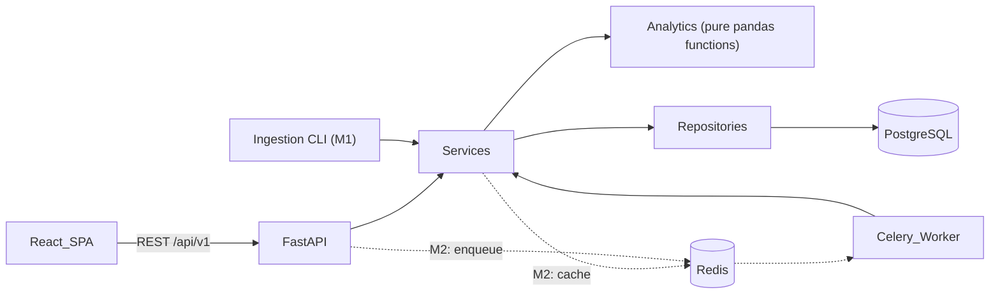

# PlaybookIQ architecture

PlaybookIQ is a football analytics app built on nflverse play-by-play data.
Milestone 1 ships a FastAPI + PostgreSQL backend, a synchronous ingestion CLI,
and a React team-comparison page.



## Layers

| Layer | Location | Responsibility |
| --- | --- | --- |
| Routes | `backend/app/api/` | Parse and validate input, call a service, shape the response. No queries, no metric math. |
| Services | `backend/app/services/` | Orchestrate repositories and analytics; build the response envelope. |
| Repositories | `backend/app/repositories/` | Own all SQLAlchemy queries. Return rows / DataFrames, never HTTP objects. |
| Analytics | `backend/app/analytics/` | Pure functions: DataFrame in, typed result out. No database, no HTTP. Unit tested with hand-built frames. |
| Ingestion | `backend/app/ingest/` | Download, checksum, validate, transform, and upsert nflverse parquet files. Invoked by the CLI now and by a Celery task in M2. |
| Models | `backend/app/models/` | SQLAlchemy 2.0 ORM models; Alembic owns migrations. |

## Analytics execution

The repository selects only the columns and rows a request needs (one team-season
is about 1,050 regular-season offensive scrimmage plays; a full season about 49.5k raw rows) and
pandas aggregates them in-process. Milestone 4 benchmarks this against SQL
`GROUP BY` aggregation so the tradeoff is measured, not guessed
(see [ADR 002](decisions/002-pandas-analytics-for-m1.md)).

## Source of truth

PostgreSQL holds all data (and, from M2, job state). Redis arrives in M2 as a
broker and cache only and must be safe to lose.

## Ingestion

`python -m app.ingest --seasons 2023,2024` downloads each season's parquet file,
computes its SHA-256, and skips the file if a completed dataset with that checksum
already exists. Rows are validated and upserted in chunks keyed on
`(game_id, external_play_id)`; invalid rows go to `rejected_rows` with a reason.
See [ADR 003](decisions/003-sync-ingestion-before-celery.md).

## Repository layout

```
backend/    FastAPI app, Alembic migrations, ingestion CLI, tests
frontend/   Vite + React + TypeScript SPA
docs/       Architecture, data, API docs, ADRs
.github/    CI workflows
```

## Deployment (local, M1)

Docker Compose runs `db` (postgres:16), `backend` (uvicorn), and `frontend`
(Vite dev server on 5317). The backend waits for a healthy database; migrations
and ingestion are explicit `make` targets, never run silently on boot.
