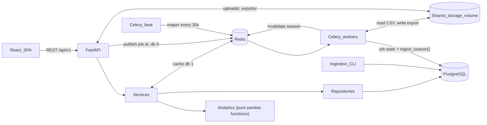
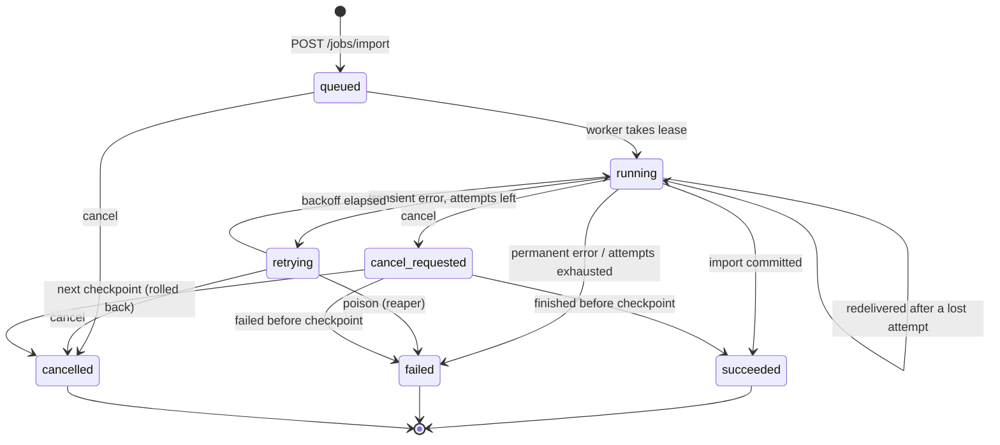
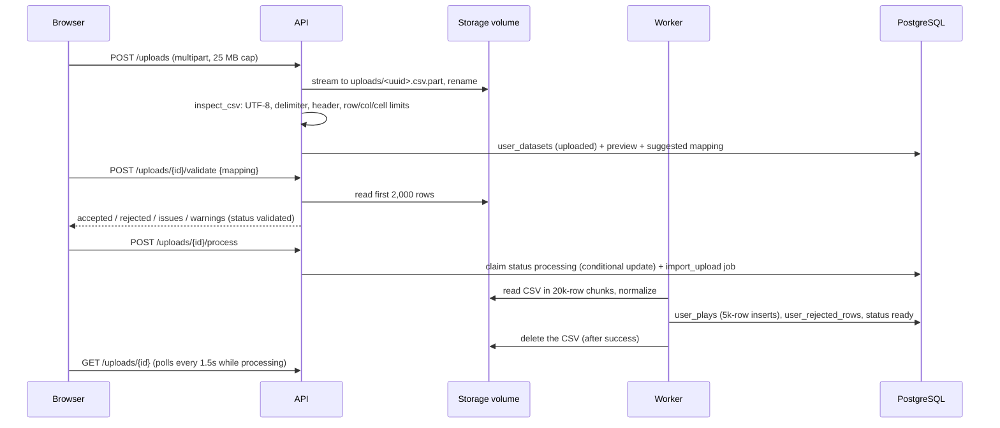

# PlaybookIQ architecture

PlaybookIQ is a football analytics app built on nflverse play-by-play data.
Milestone 1 shipped a FastAPI + PostgreSQL backend, an ingestion CLI, and a React
team-comparison page. Milestone 2 added Celery background imports, crash recovery,
a Redis analytics cache, and a Jobs dashboard. Milestone 3 adds accounts, the
situational, overview, and player explorers, private CSV uploads, and saved scouting
reports with CSV/JSON exports.



## Layers

| Layer | Location | Responsibility |
| --- | --- | --- |
| Routes | `backend/app/api/` | Parse and validate input, call a service, shape the response. No queries, no metric math. |
| Services | `backend/app/services/` | Orchestrate repositories and analytics; build the response envelope. |
| Repositories | `backend/app/repositories/` | Own all SQLAlchemy queries. Return rows / DataFrames, never HTTP objects. |
| Analytics | `backend/app/analytics/` | Pure functions: DataFrame in, typed result out. No database, no HTTP. |
| Ingestion | `backend/app/ingest/` | Download, checksum, validate, transform, and upsert nflverse parquet files. Called by the CLI and by the Celery task. |
| Jobs | `backend/app/jobs/` | State machine, submission/cancel service, runner, reaper, leases, heartbeats. |
| Worker | `backend/app/worker/` | Celery app configuration and thin task wrappers around `app.jobs`. |
| Cache | `backend/app/cache.py` | Redis read-through cache for analytics responses. |
| Auth | `backend/app/auth/` | argon2id passwords, JWT cookie sessions, rate limiter, `create-admin` CLI. |
| Sources | `backend/app/services/sources.py` | `resolve_source()`: public season or the viewer's ready upload, as one DataFrame shape. |
| Uploads | `backend/app/uploads/` | CSV inspection, field schema, mapping suggestions, normalization, processing job. |
| Reports | `backend/app/reports/` + `analytics/report.py` | Report builder (pure), saved reports service, CSV/JSON export, report and export jobs. |
| Storage | `backend/app/storage.py` | `Storage` protocol and `LocalStorage` for upload and export files. |
| Models | `backend/app/models/` | SQLAlchemy 2.0 ORM models; Alembic owns migrations. |

## Analytics execution

The repository selects only the columns and rows a request needs (one team-season
is about 1,050 regular-season offensive scrimmage plays; a full season about 49.5k raw rows) and
pandas aggregates them in-process. Milestone 4 benchmarks this against SQL
`GROUP BY` aggregation (see [ADR 002](decisions/002-pandas-analytics-for-m1.md)).

## Source of truth

PostgreSQL holds all data **and all job state**. Redis is a broker and a cache and is
safe to lose. A lost broker message is republished by the reaper, and a lost cache
means slower responses.

## Ingestion

`ingest_season()` downloads (or reuses the cached) parquet file, computes its SHA-256,
and skips the file if a completed dataset with that checksum exists. Rows are
validated and upserted in chunked statements keyed on `(game_id, external_play_id)`;
invalid rows go to `rejected_rows`. **All writes for one import are a single
transaction**, so a failure, cancellation, or crash leaves the previous data intact.
An optional progress callback runs after each chunk; the job runner uses it for
heartbeats, cancellation checks, and test fault injection.

Two entry points share it: `python -m app.ingest` (synchronous CLI, handy for scripts)
and `POST /api/v1/jobs/import` (background job). See [ADR 003](decisions/003-sync-ingestion-before-celery.md)
and [ADR 005](decisions/005-celery-job-model.md).

## Job lifecycle



The table lives in `app/jobs/state.py` and is unit tested, including a check that
every active state can reach a terminal one. Writers never `SET status = x` blindly;
they call `compare_and_set(job, sources, target)`, which validates each
`(source, target)` pair and issues `UPDATE ... WHERE status IN (sources)`. If the
row has moved on (for example, the worker started it just as the user hit cancel),
the update touches zero rows and the caller re-reads.

**One delivery, step by step** (`app/jobs/runner.py`):

1. Take the job's **lease**, `pg_try_advisory_lock(job_id)` on a dedicated
   connection. If it is held, another process is running this job, so drop the
   duplicate delivery.
2. Re-read the job. Terminal: do nothing (a redelivered message for finished work).
   `cancel_requested`: finish as `cancelled`. Mark any attempt still `running` as
   `lost`; we hold the lease, so its worker is dead.
3. `attempt_count + 1 > max_attempts`: fail as **poison**. Otherwise CAS to
   `running`, insert a `job_attempts` row, and commit.
4. Start a **heartbeat** thread (`heartbeat_at` every 5s). Run `ingest_season()`;
   after each chunk, check whether cancellation was requested.
5. Outcome:
   - Success: CAS to `succeeded` with the import summary in `result_ref`, then
     invalidate the season's cache.
   - Cancelled: `cancelled`. The transaction has already rolled back.
   - Transient error with attempts left: `retrying`, `next_retry_at = now + backoff`,
     and publish a new message with that countdown.
   - Otherwise: `failed`, with the reason.

Retry delay for attempt *n* is `min(60, 2 * 2^(n-1))` seconds with equal jitter (a
uniform draw in the upper half), so attempts 1 to 3 wait about 1-2s, 2-4s, and
4-8s. Transient means network errors, HTTP 5xx/429, DB `OperationalError`, or the
soft time limit. HTTP 404, validation errors, and bugs fail immediately.

Each job has a soft time limit (`timeout_seconds`, default 15 min), which raises
inside the task and counts as a transient failure. The hard limit (+30s) kills the
pool process, and the reaper takes over from there.

## Failure recovery and crash windows

Celery settings (`app/worker/celery_app.py`): `task_acks_late=True` (ack after the
task returns), `task_reject_on_worker_lost=True` (requeue if the pool process dies),
`worker_prefetch_multiplier=1` (reserve one message per process), and a Redis
`visibility_timeout` of 1h (redeliver unacked messages). The **reaper**
(`app/jobs/reaper.py`) runs on every worker start and every 30s via beat:

- `running`/`cancel_requested` with `heartbeat_at` older than 60s **and** a free
  lease: mark the attempt `lost`, then `retrying` (republish), `cancelled` (if
  requested), or `failed` as poison (no attempts left).
- `queued` untouched for 2 min, or `retrying` overdue by 2 min: republish.
  Duplicates are harmless because of the lease and the status check.

| Failure | What happens | Recovered by | Tested |
| --- | --- | --- | --- |
| Transient error (network, DB blip, timeout) | Attempt `failed`, job `retrying`, new message with backoff | Runner | `test_retries_after_transient_failure` |
| Persistent transient error | Gives up after `max_attempts` with "gave up after N attempts" | Runner | `test_gives_up_after_max_attempts` |
| Permanent error (404, bad data, bug) | `failed` on first attempt; transaction rolled back | Runner | `test_permanent_failure_rolls_back_the_whole_import` |
| Pool process SIGKILL/OOM mid-import | Message requeued (`reject_on_worker_lost`); next delivery marks attempt `lost`, retries | Celery + runner | `test_worker_child_killed_mid_task_is_redelivered` |
| Whole worker container killed | Message stays unacked; heartbeat goes stale, lease frees; reaper retries | Reaper | `test_whole_worker_killed_then_recovered_by_reaper` |
| Job kills its worker every time | Attempts exhausted, so `failed` as poison | Reaper / runner | `test_reaper_fails_poison_job_whose_worker_always_dies` |
| Same message delivered twice | Second delivery can't take the lease (or sees terminal status) and is dropped | Lease | `test_duplicate_submissions` |
| Client retries POST | Same `Idempotency-Key` returns the original job (200) | API | `test_idempotency_key_replays_original_job` |
| Two users import the same season | Partial unique index, so 409 `duplicate_job` | API + DB | `test_duplicate_active_submission_is_rejected` |
| User cancels while running | `cancel_requested`, stopped at next chunk, rolled back, `cancelled` | Runner | `test_cancel_running_job` |
| Redis down for analytics | `X-Cache: DEGRADED`, computed from PostgreSQL, Redis skipped for 15s | Cache | `test_redis_down_serves_uncached` |
| Redis down at submit | Job row committed, publish fails, job stays `queued`; reaper publishes later | Reaper | `test_publish_failure_still_accepts_job` (+ manual) |
| Deploy / `docker compose stop` | SIGTERM, warm shutdown: stop taking work, finish running imports (120s grace) | Celery | manual |

**Crash windows.** These are the moments where a crash produces a state that needs
the reaper or a redelivery to fix. None loses or duplicates data:

1. *API commits the job, then dies (or Redis is down) before publishing.* The job sits
   in `queued` with no message. The reaper republishes after 2 min.
2. *Worker commits `running` + attempt, then dies before the import transaction
   commits.* The import rolls back; the attempt row says `running`. On redelivery
   (pool death) or via the reaper (container death), that attempt becomes `lost` and
   the job retries.
3. *Import transaction commits, then the worker dies before writing `succeeded`.* The
   data is complete; the job still says `running`. The retry runs `ingest_season()`
   again, which sees a completed dataset with the same checksum and returns
   `skipped_duplicate`, so the job ends `succeeded` without re-importing. (For a `force`
   job the re-import rewrites identical rows: wasteful, but correct.)
4. *Job marked `succeeded`, then the worker dies before invalidating the cache.* Cache
   keys include the dataset checksum, so a new file is never served stale. Only a
   forced re-import of the identical file keeps old entries, which are identical
   anyway, until the TTL expires.
5. *Worker writes `retrying` and dies before publishing the retry.* The reaper
   republishes overdue `retrying` jobs.
6. *Task runs longer than the visibility timeout (1h).* Redis redelivers it to another
   worker, which cannot take the lease and drops it. Keep `job_timeout_seconds` well
   under the visibility timeout.

## Analytics cache

`GET /teams/{id}/stats` and `GET /analytics/team-comparison` are read-through
cached in Redis (`app/cache.py`):

- **Key:** `piq:cache:v1:{endpoint}:s{season}:d{dataset_sha[:16]}:g{generation}:{sha256(params)}`,
  where params are the resolved team ids and every filter in canonical (sorted JSON)
  form, so equivalent requests share a key.
- **TTL:** 1 hour (`CACHE_TTL_SECONDS`).
- **Invalidation tied to dataset version:** the key embeds the season's dataset
  checksum, so a new file means new keys. A successful import also increments
  `piq:cache:gen:{season}`, which retires every old key for that season at once
  (covers forced re-imports of the same file), then deletes them best-effort.
- **Counters:** hits, misses, bypasses, and invalidations in a Redis hash, exposed at
  `GET /api/v1/cache/stats` and on the Jobs page. Every response carries
  `X-Cache: HIT | MISS | BYPASS | DEGRADED | DISABLED`.
- **Bypass:** `?no_cache=true` computes fresh and does not write.
- **Degradation:** socket timeouts of 250ms. On any Redis error the request is served
  from PostgreSQL, and Redis is skipped for 15s so an outage doesn't add latency to
  every request. Readiness stays `ok` and reports `redis: unavailable`.

## Scaling workers: processes vs concurrency

There are two knobs:

- **Concurrency** (`WORKER_CONCURRENCY`, default 2) is the number of prefork **pool
  processes** inside one worker container. Each runs one job at a time. Processes
  sidestep the GIL, which matters because transforms are pandas/CPU-bound.
- **Replicas** (`docker compose up -d --scale worker=N`, or `make scale-workers WORKERS=N`)
  is the number of worker **containers**. Each has its own main process, broker
  connection, and memory limit.

Total parallel imports = replicas x concurrency. Tested configurations:

| Command | Containers | Pool processes | Parallel jobs |
| --- | --- | --- | --- |
| `make up` | 1 | 2 | 2 |
| `make scale-workers WORKERS=2` | 2 | 2 each | 4 |
| `make scale-workers WORKERS=4` | 4 | 2 each | 8 |
| `make scale-workers WORKERS=8` | 8 | 2 each | 16 |
| `WORKER_CONCURRENCY=1 make scale-workers WORKERS=8` | 8 | 1 each | 8 |

Prefer more containers when you want failure isolation (one OOM kills one container's
jobs) and independent restarts. Prefer higher concurrency when memory per container
is the constraint; one main process is shared. Each import peaks at a few hundred MB
(pandas frames for one season). Since at most one import runs per season, parallelism
helps when importing many seasons at once; M4 measures throughput across these
configurations. Run exactly **one** `beat`.

## Accounts and ownership (M3)

Users register with email and password (argon2id) and get a JWT session in an
httpOnly, `SameSite=Lax` cookie; every unsafe request also needs the
`X-PlaybookIQ-CSRF: 1` header ([ADR 009](decisions/009-argon2-jwt-cookie-sessions.md)).
Login and register are rate limited in Redis with an in-process fallback
([ADR 010](decisions/010-redis-rate-limiter-with-fallback.md)).

Ownership is enforced in the services, not the routes: every lookup of an upload,
report, export, or private job filters on `user_id`, and a miss is a 404 whether the
row does not exist or belongs to someone else. Season imports change shared data, so
only admins can start them ([ADR 008](decisions/008-generic-owner-scoped-jobs.md)).

## Data sources: public seasons and uploads (M3)

Every analytics endpoint calls `resolve_source(session, season, dataset_id, viewer)`.
It returns a `PlaySource` for either the public season (the latest completed dataset)
or one of the viewer's `ready` uploads, and the analytics read the same DataFrame
columns from either. Upload frames come from `user_plays` and are LRU-cached in process
by `(dataset_id, content_version)`. Their Redis cache keys use
`cache_scope=upload:{id}` and the upload's `content_version`, so reprocessing an
upload changes its keys ([ADR 006](decisions/006-separate-user-dataset-tables.md)).
"League" values for an upload are computed across the teams in that upload, and the
response says so in `warnings`.

## Upload pipeline (M3)



- Validation is by content, never by extension or MIME type
  ([ADR 011](decisions/011-server-side-csv-validation.md)). Files are stored under random
  names; the user's filename is display-only
  ([ADR 007](decisions/007-upload-storage-on-shared-volume.md)).
- Processing replaces the upload's previous rows in one transaction, so reprocessing
  is idempotent. No valid rows means `failed` with a reason.
- `content_version = sha256(upload id + file sha + mapping)`.
- If the job fails or is cancelled, the next read reconciles the upload to `failed`
  (or back to `validated` when cancelled), so the user can retry.

## Reports and exports (M3)

`POST /reports` checks that the viewer can read the requested data, saves a `pending`
`saved_reports` row, and queues a `generate_report` job. The job runs the pure
`build_report()` (`app/analytics/report.py`) over the same analytics functions the
explorers use, then stores the result as JSON on the row. Building is deterministic:
the same data and filters always produce the same metrics, ranks, and findings, ordered
by strength of evidence. Exports (`report_exports`) are separate `export_report` jobs
that render CSV or JSON into `exports/` on the shared volume; downloads stream from
there as attachments ([ADR 012](decisions/012-csv-json-exports-and-print.md)). The
report page prints cleanly with the browser's print dialog.

## Frontend (M3)

Pages are lazy-loaded routes: Overview, Situational, Players, Compare, My data
(`/uploads`, `/uploads/:id`), Reports (`/reports`, `/reports/:id`), and Jobs. Uploads
and reports are wrapped in `RequireAuth`. The data source, season, team, and filters
live in the URL (`season`, `dataset`, `team`, `group_by`, `down`, ...), so every view
is linkable. Shared pieces live in `src/features/analytics/` (scope picker, stat tiles,
definitions, tendency grid, charts). TanStack Query polls uploads, reports, and exports
every 1.5s only while they are processing or pending. Types come from the OpenAPI
schema (`make gen-api`), and CI fails if they are stale.

## Observability (M4)

- **Logs:** one JSON object per line on stdout/stderr (`app/observability/logging_config.py`).
  Every HTTP request gets a `request_id` (also returned as `X-Request-ID`); Celery jobs set
  `job_id` for the duration of `run_job`. Known secret field names and bearer tokens are
  redacted. Upload file bodies are never logged.
- **Metrics:** Prometheus exposition at `GET /metrics` when `METRICS_ENABLED=true` (default).
  HTTP counters/histograms use route templates to limit cardinality. SQLAlchemy statement timing,
  analytics cache outcomes, job starts/finishes/durations, and queue depth (Postgres + Celery
  Redis list length refreshed on scrape) are included. See ADR 014.
- **Dashboards:** `make observability` starts Prometheus (:9090) and Grafana (:3000, default
  login `admin` / `playbookiq`) with the provisioned **PlaybookIQ API** dashboard under
  `ops/grafana/`.
- **Load tests:** Locust (`backend/loadtests/locustfile.py`) and scripted benchmarks
  (`make bench`, raw JSON under `benchmarks/results/`). Documented in `docs/benchmarks.md`.

## Repository layout

```
backend/    FastAPI app, Celery worker, Alembic migrations, ingestion CLI, tests
frontend/   Vite + React + TypeScript SPA
docs/       Architecture, data, API docs, ADRs
.github/    CI workflows
```

## Deployment (local)

Docker Compose runs `db` (postgres:16), `redis` (redis:7, AOF on,
`volatile-lru` so only TTL'd cache keys are ever evicted), `backend` (uvicorn),
`worker` (Celery, healthchecked with `inspect ping`, 120s warm-shutdown grace),
`beat` (reaper schedule), and `frontend` (Vite on 5317). `backend` and `worker` share
the `user-storage` volume at `/app/data/storage` for uploads and exports. Migrations and CLI ingestion
are explicit `make` targets, never run silently on boot.
